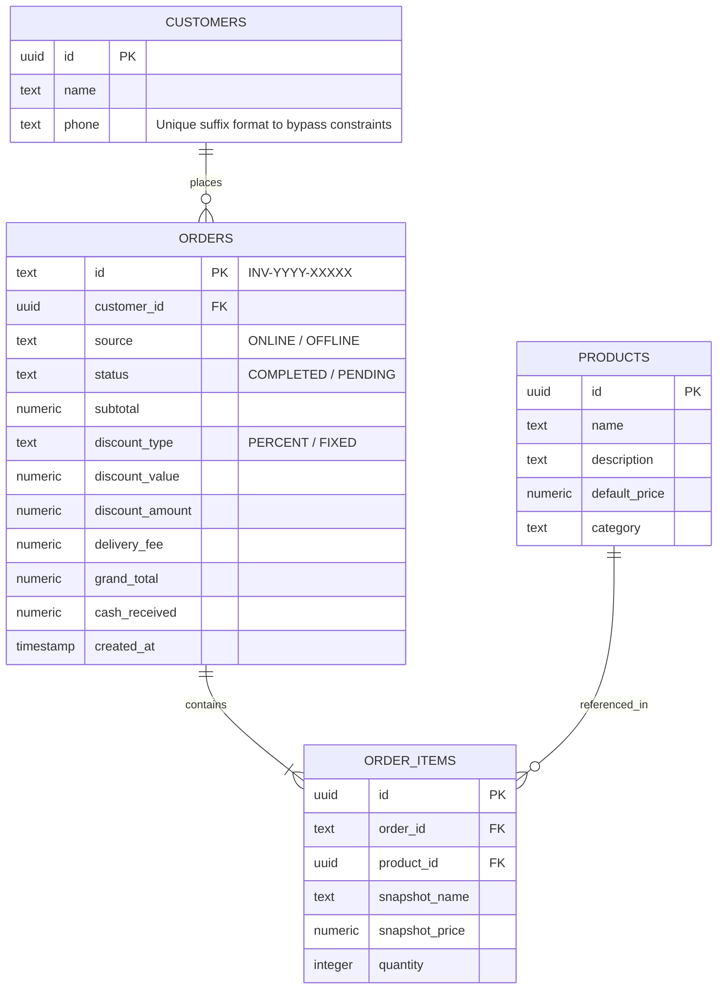

# NaNi Men's Clothing — POS & Billing System
> **Internship Project at Cenexa Systems**

An enterprise-grade, high-performance Point of Sale (POS) and Digital Billing System custom-built for **NaNi Men's Clothing** (Chennai, India). This system modernizes retail store operations by offering a fast, passcode-secured terminal for invoicing, sales tracking, real-time analytics, and instant customer communication.

Developed during the software engineering internship at **Cenexa Systems**, this application bridges the gap between traditional retail operations and cloud-based POS capabilities.

---

## 🚀 Key Features

### 1. Secure Admin Portal
* **Passcode-Protected Gateway:** Verification mechanisms ensure that only authorized store personnel can access transaction history, catalog management, and analytics.
* **Session Persistence:** Secure session management stores authentication states, preventing unauthorized route access while maintaining a smooth user experience.

### 2. POS Billing Terminal
* **Interactive Cart Manager:** Easily add items, edit quantities, and remove products with instant subtotal and tax/total recalculation.
* **Auto-Suggest Catalog Search:** Dynamically searches the product catalog as you type, allowing quick item selection and custom pricing.
* **Custom Discounts & Coupons:** Flexible discount engine supports both flat rates (e.g., ₹100 Off via `SUPERPOS`) and percentages (e.g., 10% Off via `WELCOME10` / 15% Off via `FESTIVE15`).

### 3. Digital Invoice & Printing
* **Print-Optimized Invoices:** Seamless support for physical thermal/laser printer output with hidden navbars and clean margins.
* **Interactive Bill Link Sharing:** Generate unique, shareable URLs (`/invoice/[id]`) for customers to view and download their digital PDF receipts anytime.
* **Secure Invoice ID Generator:** Prevents predictability by generating unique IDs using format `INV-[YYYY]-[5-char-alphanumeric]`.

### 4. WhatsApp Receipt Delivery
* **Direct Customer Reach:** Automatically generates formatted markdown receipt messages and initiates WhatsApp redirection to send digital bills to customer mobile numbers.

### 5. Real-Time Analytics Dashboard
* **Sales Trends & Revenue Analysis:** Interactive graphs and metrics detailing total revenue, average order value, and order counts.
* **Channels & Coupons Tracker:** Tracks the split between ONLINE vs OFFLINE orders and displays usage statistics for promotional codes.
* **Sales Period Filters:** Instantly slice sales data by Today, Week, Month, Year, or Custom date ranges.

---

## 🛠️ Tech Stack

* **Frontend:** Next.js 16 (App Router), React 19, TypeScript
* **Styling:** TailwindCSS v4, Lucide React (Icons)
* **Backend Database:** Supabase (Postgres)
* **Hosting / API Routing:** Next.js Server Actions & Edge runtime

---

## 📊 Database Schema (Supabase Postgres)

The system leverages four primary tables to manage inventory, customers, orders, and individual items:



*Note: The `customers` table utilizes a dynamic split-suffix phone constraint (`phone_name_timestamp`) to bypass standard database unique constraints, allowing customers to use the same phone number for multiple independent checkouts while maintaining raw phone numbers in the user interface.*

---

## ⚙️ Environment Configuration

Create a `.env` (or `.env.local`) file in the root of the project with the following configuration:

```env
# Supabase Integration
NEXT_PUBLIC_SUPABASE_URL="your-supabase-project-url"
NEXT_PUBLIC_SUPABASE_ANON_KEY="your-supabase-anon-key"

# Business Information
NEXT_PUBLIC_STORE_PHONE="9940088786"

# Admin Dashboard Passcode
NEXT_PUBLIC_PASSCODE="your-secure-passcode"
```

---

## 🏃 Getting Started

### 1. Clone the project and navigate to the directory:
```bash
cd pos-billing-system
```

### 2. Install dependencies:
```bash
npm install
```

### 3. Run the development server:
```bash
npm run dev
```

### 4. Open the application:
Access the billing system at [http://localhost:3000](http://localhost:3000). To access the admin control panel, navigate to `/pos/admin/secure/control-panel/nani-clothing` and log in with your configured passcode.

---

## 💼 Internship Context (Cenexa Systems)

This project was built during the software engineering internship at **Cenexa Systems**. 

### Objectives & Learnings:
1. **Full-Stack Development:** Built a responsive, secure React interface integrated with Supabase cloud infrastructure.
2. **Database Architecture:** Designed a normalized database schema with performance optimization strategies to prevent data degradation during offline/online synchronization.
3. **Enterprise UI/UX Design:** Designed a cohesive visual language utilizing vanilla styling patterns for high contrast readability inside active retail spaces.
4. **Third-Party Integrations:** Implemented seamless print hooks and WhatsApp API integrations for automated checkout notifications.
